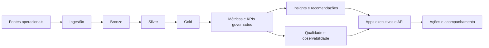

# Revenue Intelligence Platform Suite

[](https://github.com/samuelmaia-analytics/revenue-intelligence-platform-suite)
[](https://revenue-intelligence-platform.streamlit.app/)
[](https://www.python.org/downloads/)

**Idioma:** `Português (BR)` | [English](README.en.md) | [Português (PT)](README.pt-PT.md)

> Empresas que acompanham receita, retenção e desempenho comercial costumam lidar com métricas espalhadas, definições inconsistentes e dificuldade para transformar sinais em prioridade de ação. Para enfrentar esse problema, construí uma plataforma de Revenue Intelligence que conecta ingestão, transformação, métricas governadas, qualidade, observabilidade, insights executivos, aplicações e acompanhamento de ações. O resultado é uma arquitetura reutilizável em que diferentes consumidores usam a mesma camada de métricas e regras, reduzindo ambiguidade e favorecendo decisões mais consistentes.

**[→ Acessar demonstração](https://revenue-intelligence-platform.streamlit.app/)**

---

## Método CAR

**Contexto:** decisões de receita e retenção perdem confiabilidade quando KPIs, regras e sinais de risco ficam espalhados em diferentes dashboards ou processos manuais.

**Ação:** desenvolvi uma plataforma com Python, SQL, dbt, Streamlit, FastAPI, Prefect, DuckDB e controles de qualidade, observabilidade, governança e privacidade, além de uma camada semântica para padronizar métricas e apoiar diferentes pacotes de solução.

**Resultado:** a arquitetura centraliza sinais de receita e retenção, reutiliza definições governadas entre diferentes consumidores e permite priorizar riscos e oportunidades com uma base analítica mais consistente. Como projeto de portfólio, demonstra capacidade implementada sem atribuir resultados financeiros não medidos em uma empresa real.

---

## O que este projeto resolve

Empresas com receita recorrente normalmente precisam combinar informações de clientes, vendas, retenção, indicadores e ações comerciais antes de decidir onde atuar primeiro.

O Revenue Intelligence Platform Suite organiza esse fluxo em uma plataforma reutilizável que conecta ingestão, transformação, métricas governadas, qualidade, insights executivos, aplicações e acompanhamento das ações tomadas.

O objetivo é responder perguntas como:

- quais clientes ou contas representam maior risco de receita;
- quais ações devem ser priorizadas primeiro;
- quais KPIs são confiáveis para a tomada de decisão;
- como acompanhar risco, oportunidade e evolução dos resultados;
- como adaptar a mesma base analítica para diferentes contextos de negócio.

---

## Visão da solução




---

## Principais entregas

- Estrutura de dados em camadas para evolução de fontes brutas até métricas executivas.
- Catálogo semântico para padronização de KPIs e regras de negócio.
- Controles de qualidade, contratos, observabilidade e acompanhamento de freshness.
- Dashboard executivo em Streamlit para acompanhamento de receita, risco, retenção e prioridades.
- API em FastAPI para disponibilização das informações analíticas.
- Camada de insights executivos baseada em métricas e regras controladas.
- Configuração reutilizável para diferentes clientes, ambientes e pacotes de solução.
- Geração de artefatos executivos e comerciais, incluindo review packs, propostas e microsites.
- Controles de governança, privacidade e isolamento de informações por cliente.
- Testes e validações automatizadas para apoiar a confiabilidade da plataforma.

---

## Impacto demonstrado

O projeto demonstra como uma solução analítica pode:

- centralizar sinais de receita e retenção em uma visão executiva;
- reduzir ambiguidade na interpretação de KPIs por meio de definições governadas;
- priorizar riscos e oportunidades com base no impacto financeiro;
- apoiar ciclos recorrentes de acompanhamento e tomada de decisão;
- reutilizar uma mesma arquitetura para diferentes clientes e segmentos;
- conectar análise de dados, governança, engenharia e contexto de negócio em um único produto analítico.

> Este é um projeto de portfólio e demonstração. Os benefícios acima representam capacidades implementadas e objetivos de uso da plataforma, não resultados financeiros obtidos em uma empresa real.

---

## Tecnologias

| Área | Tecnologias e práticas |
|---|---|
| Dados e Analytics | Python · Pandas · SQL |
| Analytics Engineering | dbt · camadas Bronze/Silver/Gold · semantic metrics |
| Machine Learning | scikit-learn · MLflow |
| Qualidade e contratos | Pandera · contratos de dados · quality gates |
| Aplicações | Streamlit · FastAPI |
| Orquestração | Prefect |
| Persistência e telemetria | DuckDB · SQLite |
| Entrega | Docker Compose · automação por scripts |
| Governança | LGPD baseline · retenção · RACI · isolamento por cliente |

---

## Pacotes de solução

A arquitetura pode ser utilizada em diferentes frentes:

- **Revenue Command Center** — acompanhamento executivo de receita e prioridades.
- **Retention Intelligence** — identificação e priorização de risco de churn e retenção.
- **Executive KPI Governance** — definição, ownership, qualidade e consumo confiável de indicadores.
- **Commercial Performance Analytics** — análise de desempenho comercial, segmentos, canais e margem.

Mais detalhes estão em [`docs/solutions/`](./docs/solutions/).

---

## Estrutura do projeto

```text
revenue-intelligence-platform-suite/
├── apps/                    # dashboards, API e superfícies operacionais
├── modules/                 # módulos de domínio e analytics
├── packages/common/         # contratos, configuração e componentes reutilizáveis
├── platform/                # componentes centrais da plataforma
├── platform_connectors/     # conectores
├── platform_observability/  # monitoramento e telemetria
├── reports/showcase/        # evidências e resultados do showcase
├── docs/                    # arquitetura, governança e documentação executiva
└── tests/                   # testes e validações
```

---

## Como revisar este projeto em 5 minutos

1. Acesse a **[demonstração pública](https://revenue-intelligence-platform.streamlit.app/)**.
2. Observe a arquitetura apresentada neste README.
3. Consulte [`docs/architecture.md`](./docs/architecture.md) para o desenho técnico completo.
4. Veja os pacotes de solução em [`docs/solutions/`](./docs/solutions/).
5. Consulte [`docs/proof.md`](./docs/proof.md) e [`docs/executive-brief.md`](./docs/executive-brief.md) para evidências e contexto executivo.

---

## Execução local

Instalação e validação:

```bash
make install
make lint
make test
```

Executar showcase, aplicação e API:

```bash
make showcase
make app
make api
```

Stack local:

```bash
make demo-stack
```

---

## Governança e GenAI

A camada de geração de insights foi estruturada para trabalhar sobre métricas e regras controladas, com fallback determinístico e artefatos persistidos para revisão. A proposta é utilizar GenAI como apoio à interpretação, sem substituir os controles de qualidade e governança da plataforma.

Documentação relacionada:

- [`docs/genai-governance.md`](./docs/genai-governance.md)
- [`docs/semantic-metric-layer.md`](./docs/semantic-metric-layer.md)
- [`docs/privacy-and-lgpd-policy.md`](./docs/privacy-and-lgpd-policy.md)
- [`docs/governance-raci.md`](./docs/governance-raci.md)
- [`docs/compliance-checklist.md`](./docs/compliance-checklist.md)

---

## Documentação técnica

Para detalhes de implementação, consulte:

- [Arquitetura](./docs/architecture.md)
- [Documentação geral](./docs/README.md)
- [Prova e evidências](./docs/proof.md)
- [Resumo executivo](./docs/executive-brief.md)
- [Scorecard de KPIs](./docs/kpi-scorecard.md)
- [Roadmap de productização](./docs/productization-roadmap.md)
- [Guia Docker Compose](./docs/docker-compose.md)

---

## Links

- **Demo:** https://revenue-intelligence-platform.streamlit.app/
- **Repositório:** https://github.com/samuelmaia-analytics/revenue-intelligence-platform-suite
- **LinkedIn:** https://www.linkedin.com/in/samuelmaia-analytics/

---

## Autor

**Samuel Maia** — Analista de Dados | Analytics Engineer

Projeto de portfólio voltado à aplicação prática de Data Analytics, Analytics Engineering, governança, qualidade de dados e suporte à decisão de negócio.

---

## Licença

Este trabalho está licenciado sob Creative Commons Attribution-NonCommercial 4.0 International (CC BY-NC 4.0).

Consulte o arquivo [LICENSE](./LICENSE) para os termos aplicáveis.
