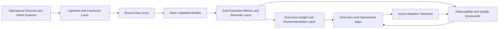
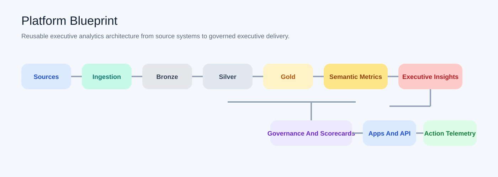
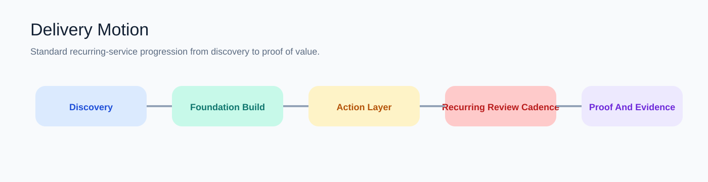
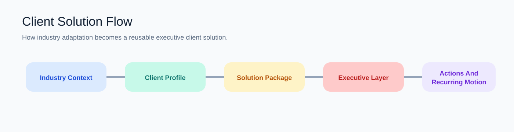
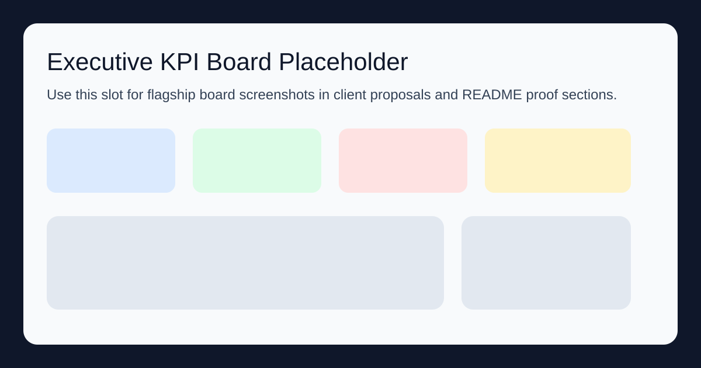
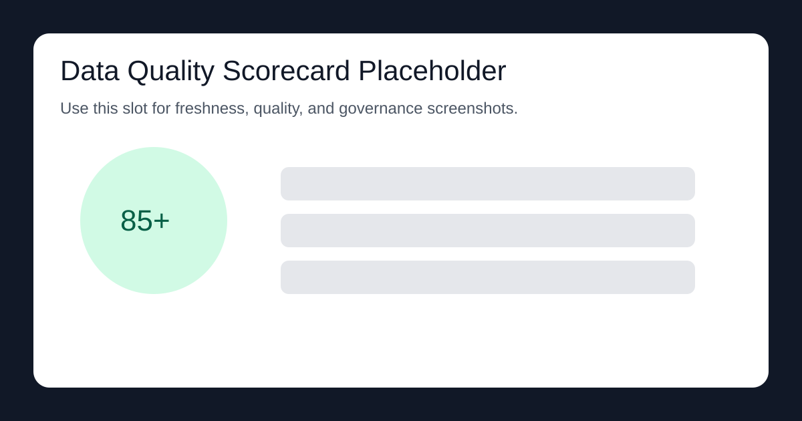
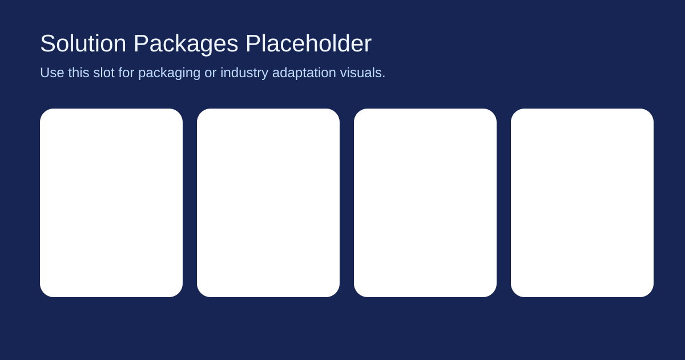
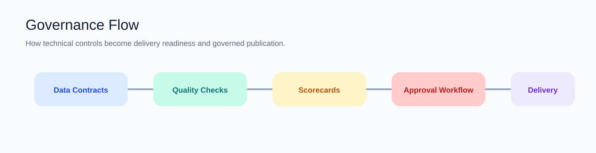

# Revenue Intelligence Platform Suite

Enterprise-grade analytics platform template for revenue, retention, KPI governance, and recurring executive decision support.

[](https://github.com/samuelmaia-analytics/revenue-intelligence-platform-suite/actions/workflows/ci.yml)
[](https://github.com/samuelmaia-analytics/revenue-intelligence-platform-suite/actions/workflows/publish-release.yml)
[](https://github.com/samuelmaia-analytics/revenue-intelligence-platform-suite/actions/workflows/showcase-monitoring.yml)
[](https://github.com/samuelmaia-analytics/revenue-intelligence-platform-suite/releases/tag/v1.0.0)

Live demo: https://revenue-intelligence-platform.streamlit.app/

Copyright notice: the public Streamlit app is available for viewing, but the platform, source code, generated assets, and commercial materials remain proprietary to Samuel Maia under the root [LICENSE](./LICENSE).

## Language
- English (canonical): [README.md](README.md)
- Portuguese (BR): [README.pt-BR.md](README.pt-BR.md)
- Portuguese (PT): [README.pt-PT.md](README.pt-PT.md)

## What This Platform Is
This repository is built as a reusable analytics product foundation, not a standalone dashboard or isolated ML project. It is designed to be adapted into client-facing solutions such as:
- revenue command centers
- retention intelligence programs
- executive KPI governance layers
- commercial performance analytics systems

It brings together:
- a multi-module monorepo
- executive and operational applications
- governed metrics, contracts, and observability
- a FastAPI serving surface
- reusable executive, commercial, and go-to-market assets
- repository-level controls for LGPD baseline, governance, and proprietary authorship
- optional enterprise SSO enforcement for protected client environments

## Who It Is For
- CROs, revenue leaders, and RevOps teams
- customer success and retention leadership
- COOs, CFOs, strategy teams, and executive PMOs
- analytics consultancies and productized data service teams
- SaaS, healthtech, retail, and recurring-revenue operators

## Business Outcomes
- reduce revenue exposure by ranking the highest-value actions first
- shorten executive decision cycles with trusted KPI definitions
- operationalize recurring reviews around risk, opportunity, and adoption
- accelerate client delivery with reusable white-label assets

## The Executive Lens
The platform is designed around the questions executive teams actually ask:
- what is at risk
- why it matters
- what should happen next
- who owns the action
- whether the action changed the outcome

The flagship showcase answers:
1. Which accounts currently carry the highest revenue-at-risk?
2. Which actions should leadership prioritize first?
3. How much value can realistically be recovered under different scenarios?
4. Is the decision layer healthy enough to be trusted in an executive cadence?

## Solution Packages
| Package | Primary buyer | Core promise |
|---|---|---|
| Revenue Command Center | CRO / RevOps | Turn fragmented revenue signals into a weekly executive operating system. |
| Retention Intelligence | Customer Success leadership | Detect churn exposure early and rank save plays by financial impact. |
| Executive KPI Governance | CEO / COO / CFO | Standardize definitions, freshness, ownership, and trusted KPI consumption. |
| Commercial Performance Analytics | Sales / Commercial Ops | Improve seller, channel, segment, and margin performance visibility. |

Supporting docs:
- [docs/solutions/revenue-command-center.md](./docs/solutions/revenue-command-center.md)
- [docs/solutions/retention-intelligence.md](./docs/solutions/retention-intelligence.md)
- [docs/solutions/executive-kpi-governance.md](./docs/solutions/executive-kpi-governance.md)
- [docs/solutions/commercial-performance-analytics.md](./docs/solutions/commercial-performance-analytics.md)

## How It Turns Into A Client Solution
The platform is structured for white-label delivery and multi-client reuse:
- `global` configuration for shared platform defaults
- `environment` configuration for local, demo, staging, and production behavior
- `client` configuration for thresholds, branding, connectors, and KPI focus
- `solution package` configuration for delivery model and executive narrative

Reusable client assets already generated by the platform include:
- `reports/showcase/summary.json`
- `reports/showcase/solution_profile.json`
- `reports/showcase/data_quality_scorecard.json`
- `reports/showcase/executive_insights.json`
- `dist/executive-review-pack/`
- `dist/client-proposal-pack/`
- `dist/client-microsite/`
- `dist/deal-rooms/<deal-slug>/`

## Architecture


Core enterprise blueprint:
- ingestion and connector abstraction
- raw-to-curated data promotion
- semantic metric governance
- recommendation and executive insight generation
- observability, freshness, contracts, and action telemetry
- executive and commercial serving surfaces

Detailed architecture: [docs/architecture.md](./docs/architecture.md)

Static blueprint:
- 

## Repository Structure
```text
revenue-intelligence-platform-suite/
|- apps/                     # executive apps, API, and operational surfaces
|- modules/                  # flagship domain modules and integrated portfolio assets
|- packages/common/          # contracts, configuration, and productization logic
|- platform/                 # blueprint-aligned platform namespaces
|- platform_connectors/      # runtime-safe connectors
|- platform_observability/   # monitoring and action adoption services
|- reports/showcase/         # generated showcase artifacts
|- docs/                     # architecture, commercial, governance, and release docs
`- tests/                    # smoke, contract, and platform validation
```

## Delivery Model
- discovery and KPI framing
- source mapping and contract definition
- client adaptation by profile and package
- executive dashboard and API deployment
- weekly operating cadence with action telemetry
- quarterly proof, release evidence, and realized-outcome review

Commercial references:
- [docs/commercial/executive_one_pager.md](./docs/commercial/executive_one_pager.md)
- [docs/commercial/client_use_cases.md](./docs/commercial/client_use_cases.md)
- [docs/commercial/service_packaging.md](./docs/commercial/service_packaging.md)
- [docs/commercial/pricing_logic.md](./docs/commercial/pricing_logic.md)
- [docs/commercial/implementation_roadmap.md](./docs/commercial/implementation_roadmap.md)
- [docs/approval-workflow.md](./docs/approval-workflow.md)

Commercial and delivery visuals:
- 
- 

## Industry Adaptation Paths
- SaaS: NRR, churn exposure, expansion motion, lifecycle health
- Healthtech: lifecycle usage decline, retention exposure, operational revenue leakage
- Retail and e-commerce: repeat-purchase risk, channel efficiency, recovery campaigns
- Commercial operations: seller performance, pipeline velocity, margin leakage
- Recurring service businesses: renewal risk, save actions, account prioritization

## Recurring Service Operating Model
- weekly executive review with KPI board and action register
- monthly quality and freshness review
- quarterly release evidence and realized-outcome review
- ongoing connector expansion and client-specific semantic tuning

## Demo And Proof Surfaces
Primary surfaces:
- `apps/executive-dashboard/app.py`
- `apps/executive-dashboard/pages/1_Executive_KPI_Board.py`
- `apps/executive_api/main.py`

Proof visuals:
- 
- 
- 
- 

## Quick Start
Install and validate:
```bash
make install
make lint
make test
```

Core showcase:
```bash
make showcase
make app
make api
```

Client-adapted showcase:
```bash
CLIENT_PROFILE=healthtech_growth SOLUTION_PACKAGE=retention_intelligence python scripts/run_showcase_demo.py
```

Local demo stack:
```bash
make demo-stack
make protected-demo-stack
make google-workspace-demo-stack
```

Executive and commercial asset generation:
```bash
make review-pack
make proposal-pack PROPOSAL_CLIENT_NAME="Acme Corp"
make microsite PROPOSAL_CLIENT_NAME="Acme Corp"
make deal-room PROPOSAL_CLIENT_NAME="Acme Corp" DEAL_NAME="Acme Expansion FY26"
make approval-pack PROPOSAL_CLIENT_NAME="Acme Corp" DEAL_NAME="Acme Expansion FY26"
make publish-bundle PROPOSAL_CLIENT_NAME="Acme Corp" DEAL_NAME="Acme Expansion FY26" PUBLISH_BASE_URL="https://demo.example.com"
make prepare-pages PROPOSAL_CLIENT_NAME="Acme Corp" DEAL_NAME="Acme Expansion FY26" PUBLISH_BASE_URL="https://your-user.github.io/your-repo"
make sales-bundle PROPOSAL_CLIENT_NAME="Acme Corp" DEAL_NAME="Acme Expansion FY26"
make gtm-exports PROPOSAL_CLIENT_NAME="Acme Corp" DEAL_NAME="Acme Expansion FY26"
make evidence-pack RELEASE_TAG=v1.0.0
```

Industry demo and benchmark generation:
```bash
make industry-packs
make benchmark
```

Modern data stack helpers:
```powershell
powershell -ExecutionPolicy Bypass -File .\modules\revenue-intelligence\scripts\run_modern_data_stack_demo.ps1
powershell -ExecutionPolicy Bypass -File .\modules\revenue-intelligence\scripts\setup_envs.ps1
```

## Expected Outputs
- `reports/showcase/summary.json`
- `reports/showcase/solution_profile.json`
- `reports/showcase/data_quality_scorecard.json`
- `reports/showcase/executive_insights.json`
- `reports/showcase/top_actions.csv`
- `dist/executive-review-pack/`
- `dist/client-proposal-pack/`
- `dist/client-microsite/`
- `dist/deal-rooms/<deal-slug>/`
- `dist/deal-rooms/<deal-slug>/approvals/`
- `dist/deal-rooms/<deal-slug>/publication/`
- `dist/github-pages/<deal-slug>/`
- `dist/deal-rooms/<deal-slug>/sales-enablement/`
- `dist/deal-rooms/<deal-slug>/sales-enablement/exports/`
- `dist/release-evidence-pack-<tag>.tar.gz`
- `dist/industry-demo-packs/<profile>/`
- `dist/benchmarks/industry_benchmark.csv`

## Technology Baseline
- Python with Pandas, scikit-learn, Streamlit, FastAPI, Pandera, Prefect, and MLflow
- dbt project inside `modules/revenue-intelligence/dbt`
- contract validation in `packages/common/contracts`
- semantic metric catalog in `config/semantic_metrics.json`
- telemetry connectors for SQLite and DuckDB
- monitoring and action adoption tracking in `platform_observability`

## Governance And GenAI
Executive insight generation is implemented as a controlled, auditable layer:
- deterministic fallback instead of gimmick chat UX
- outputs generated from validated metrics and thresholds
- prompts, rules, and artifacts persisted for review
- governed usage documented in [docs/genai-governance.md](./docs/genai-governance.md)

Key governance docs:
- [docs/README.md](./docs/README.md)
- [docs/commands-reference.md](./docs/commands-reference.md)
- [docs/proof.md](./docs/proof.md)
- [docs/executive-brief.md](./docs/executive-brief.md)
- [docs/kpi-scorecard.md](./docs/kpi-scorecard.md)
- [docs/semantic-metric-layer.md](./docs/semantic-metric-layer.md)
- [docs/privacy-and-lgpd-policy.md](./docs/privacy-and-lgpd-policy.md)
- [docs/data-retention-matrix.md](./docs/data-retention-matrix.md)
- [docs/client-data-onboarding-template.md](./docs/client-data-onboarding-template.md)
- [docs/tenant-secrets.md](./docs/tenant-secrets.md)
- [docs/sso.md](./docs/sso.md)
- [docs/governance-raci.md](./docs/governance-raci.md)
- [docs/compliance-checklist.md](./docs/compliance-checklist.md)
- [LICENSE](./LICENSE)
- [NOTICE](./NOTICE)

## Tenant Secrets And Client Isolation
The platform now includes a tenant-aware secrets layer with masked readiness reporting:
- template-driven secret requirements in `config/secrets/templates/`
- real secret paths ignored by Git
- per-client and per-environment secret resolution
- masked readiness output in `reports/showcase/tenant_secret_status.json`
- API visibility through `/profiles/{profile_id}/secret-status`

Validation:
```bash
make tenant-secrets-check
CLIENT_PROFILE=healthtech_growth DEPLOYMENT_ENV=production make tenant-secrets-check
```

## Release And Roadmap
- Current release: `v1.0.0`
- Quarterly notes: [docs/releases/2026-Q1.md](./docs/releases/2026-Q1.md)
- Productization backlog: [docs/productization-roadmap.md](./docs/productization-roadmap.md)
- Docker guide: [docs/docker-compose.md](./docs/docker-compose.md)
- Release evidence: [docs/release-evidence-pack.md](./docs/release-evidence-pack.md)

## Why This Strengthens Commercial Positioning
This repository now behaves like a sellable analytics platform template because it combines:
- executive problem framing
- multi-client and white-label configuration
- governed KPI and semantic metric definitions
- reusable delivery assets for proposals, reviews, and deal rooms
- operational proof for recurring-service delivery
