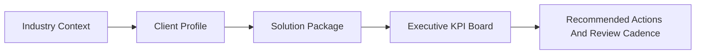

# Client Use Cases

## Industry Map
| Segment | Primary problem | Core value from the platform |
|---|---|---|
| SaaS | churn and expansion exposure | governed retention and revenue operating layer |
| Healthtech | lifecycle degradation and leakage | earlier detection and intervention prioritization |
| Retail and E-commerce | repeat-purchase decline and channel leakage | commercial visibility with recovery framing |
| Commercial Operations | seller and territory variance | executive-grade performance review |
| Recurring Services | renewals and adoption risk | save-motion prioritization and recurring steering |

## SaaS
- Prioritize accounts by churn exposure, expansion risk, and revenue-at-risk.
- Monitor NRR, gross churn, recovery opportunity, and action adoption.
- Run weekly executive save-motion reviews backed by governed metrics.

## Healthtech
- Detect lifecycle or cohort degradation before it becomes revenue leakage.
- Quantify retention exposure using usage, account, or provider behavior.
- Align customer success, operations, and commercial intervention plans.

## Retail And E-commerce
- Identify repeat-purchase decline, channel inefficiency, and campaign leakage.
- Monitor AOV, conversion, retention proxies, and recovery scenarios.
- Support merchandising, CRM, and commercial prioritization with one executive layer.

## Commercial Operations
- Expose seller, territory, and channel performance variance.
- Improve forecast reviews with trusted KPI definitions and executive drill-downs.
- Focus leadership reviews on the most material gaps and opportunities.

## Recurring Service Businesses
- Prioritize renewal and save actions by financial value.
- Track service-adoption proxies and operating risk by client segment.
- Operationalize recurring executive reviews with scorecards and action telemetry.

## Reuse Pattern

