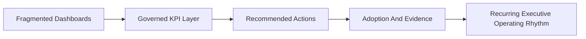

# Executive One Pager

## At A Glance
| Area | Summary |
|---|---|
| Offer | Productized analytics platform for revenue, retention, governance, and action prioritization |
| Primary buyers | CRO, RevOps, Customer Success leadership, COO, CFO |
| Core motion | Executive decision support with recurring review cadence |
| Delivery model | Strategy + build + recurring managed service |

## Offer
Revenue Intelligence Platform Suite is a productized analytics foundation for organizations that need one executive layer for revenue performance, retention exposure, KPI governance, and action prioritization.

## Executive Problem
Most leadership teams are working with fragmented dashboards, inconsistent metric definitions, and no closed loop between risk detection and action execution. That creates reactive reviews, weak accountability, and delayed decisions.

## What This Changes
- Revenue and retention risk are visible in a single executive view.
- KPI definitions become governed, repeatable, and easier to trust.
- Actions are ranked by financial impact rather than intuition.
- Adoption and evidence become part of the operating rhythm.

## Value Flow

## Primary Buyers
- CRO
- VP Revenue Operations
- VP Customer Success
- COO
- CFO

## What The Buyer Receives
- executive KPI board
- recommended action layer
- data quality and freshness scorecard
- recurring review cadence with evidence packs

## Delivery Models
- strategy plus implementation
- recurring analytics managed service
- white-label analytics platform foundation
