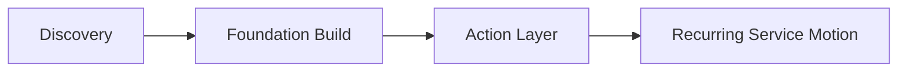

# Implementation Roadmap

## Phase Summary
| Phase | Focus | Main output |
|---|---|---|
| 1 | discovery and alignment | decision map, KPI owners, source scope |
| 2 | foundation build | configured platform baseline |
| 3 | action layer | prioritization, ownership, telemetry |
| 4 | recurring service motion | operating cadence and evidence pack |

## Phase 1: Discovery And Alignment
- define the executive decisions the solution must support
- map source systems, connector feasibility, and data contracts
- standardize KPI definitions, thresholds, and owners

## Phase 2: Foundation Build
- configure ingestion, contracts, scorecards, and semantic metrics
- adapt the showcase package, client profile, branding, and executive narrative
- deploy the flagship KPI board and serving layer

## Phase 3: Action Layer
- prioritize accounts, opportunities, or segments by financial value
- operationalize recommended actions, ownership, and status tracking
- instrument adoption telemetry and realized-outcome review

## Phase 4: Recurring Service Motion
- run weekly executive reviews
- publish monthly quality and performance scorecards
- package quarterly release evidence, proposal refreshes, and realized deltas

## Delivery Timeline

