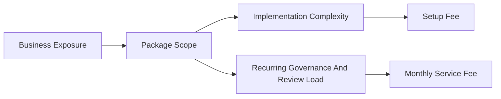

# Pricing Logic

## Pricing Summary
| Driver | Why it matters |
|---|---|
| source-system complexity | changes implementation effort and connector risk |
| KPI semantic complexity | affects governance and metric-layer design |
| dashboard and narrative customization | changes executive-facing adaptation work |
| monitoring and SLA expectations | drives recurring operating load |
| white-label and API scope | increases productization depth and delivery surface |

## What Drives Price
- number and complexity of source systems
- complexity of semantic KPI definitions
- level of executive dashboard customization
- monitoring cadence, freshness expectations, and governance requirements
- need for white-label, multi-client, or API enablement

## Commercial Structure
- setup fee for discovery, architecture alignment, initial delivery, and adaptation
- monthly recurring fee for monitoring, scorecards, executive support, and iteration
- optional premium for advanced connector work, predictive modeling, API serving, and GTM automation

## Positioning Principle
Price the solution against business exposure, executive leverage, and delivery acceleration, not against dashboard count or implementation hours alone.

## Upsell Paths
- retention playbooks and action-adoption telemetry
- industry-specific semantic metric layers
- API or warehouse deployment
- board-report automation, release evidence packs, and deal-room generation

## Commercial Logic

