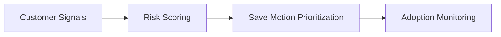

# Retention Intelligence

## Package Summary
| Area | Summary |
|---|---|
| Buyer | Chief Customer Officer, VP Customer Success, Retention Ops |
| Promise | detect churn exposure early and concentrate save effort where value is highest |
| Primary KPIs | gross churn, churn exposure, expected recovery, adoption |

## Target Buyer
Chief Customer Officer, VP Customer Success, Retention Ops.

## Executive Promise
Detect churn exposure early, focus teams on the highest-value save motions, and track whether actions were actually adopted.

## Typical KPIs
- gross churn
- churn exposure
- expected recovery
- save-motion adoption

## Core Assets
- risk scoring
- account prioritization
- recommended save actions
- adoption monitoring

## Solution Flow

## Why It Sells
This package is effective when retention leaders need earlier signals, clearer ownership, and an executive-quality view of where save effort should concentrate.
