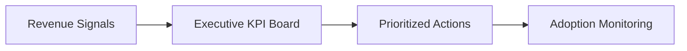

# Revenue Command Center

## Package Summary
| Area | Summary |
|---|---|
| Buyer | CRO, VP Revenue, Revenue Operations |
| Promise | one executive operating layer for revenue posture and action follow-through |
| Primary KPIs | revenue at risk, NRR, recovery value, action adoption |

## Target Buyer
CRO, VP Revenue, Revenue Operations.

## Executive Promise
Create one executive operating layer that combines revenue performance, risk exposure, prioritization, and action follow-through.

## Typical KPIs
- revenue at risk
- NRR
- recovery value
- action adoption rate

## Core Assets
- executive KPI board
- recommended action register
- scenario analysis
- telemetry-backed monitoring

## Solution Flow

## Why It Sells
This package is strong when the buyer has multiple dashboards, weak action accountability, and no clear prioritization mechanism for recurring revenue protection.
