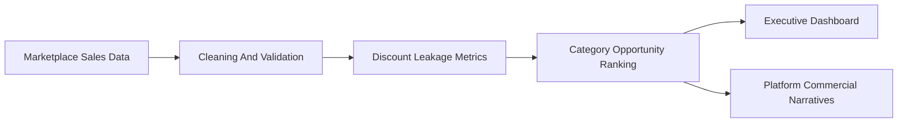

> This repository is part of the **Revenue-Intelligence-Platform-Suite**
> Main platform: ../../README.md

# Amazon Sales Analytics

## Language
- English docs: [docs/README.en.md](docs/README.en.md)
- Portugues (BR): [docs/README.pt-BR.md](docs/README.pt-BR.md)
- Portugues (PT): [docs/README.pt-PT.md](docs/README.pt-PT.md)

## Purpose
This module focuses on discount leakage, category performance, and recoverable commercial value in marketplace-style sales data.

## Executive Summary
- business problem: discount strategy can protect volume while quietly eroding net revenue
- primary audience: Revenue Ops, Sales Leadership, Category Managers
- north star metric: `NRR` as `net revenue / gross revenue before discounts`
- value case: recovering a small share of leakage already produces meaningful upside

## Business Snapshot
- Net Revenue: **$32.87M**
- Discount Leakage: **$5.05M**
- NRR: **86.69%**
- 5% leakage recovery scenario: **+$252.3K**

## Flow


## What It Delivers
- category-level leakage diagnostics
- recoverable value estimates
- executive KPI framing around discount governance
- tested contracts and repeatable analysis outputs

## How It Fits In The Platform
- supports `Commercial Performance Analytics`
- complements revenue and retention modules with margin-protection logic
- strengthens the platform's story for commerce and retail use cases

## Run Locally
```bash
cd modules/amazon-sales-analysis
pip install -r requirements.txt
python main.py
streamlit run app/streamlit_app.py
```

## Notes
This module keeps its own depth in `docs/`, while the root README now stays focused on executive framing, output value, and platform fit.
