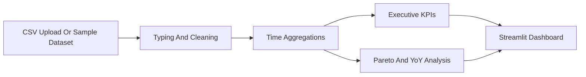

> This repository is part of the **Revenue-Intelligence-Platform-Suite**
> Main platform: [../../README.md](../../README.md)

# Sales Analytics Dashboard

## Language
- English: [README.en.md](README.en.md)
- Portugues (BR): [README.md](README.md)
- Portugues (PT): [README.pt-PT.md](README.pt-PT.md)

## Purpose
This module is the operational sales analytics layer of the suite. It turns transactional sales data into executive KPIs, growth views, Pareto concentration analysis, and seasonality signals.

## What It Delivers
- period-over-period growth analysis
- executive sales KPIs
- Pareto concentration views by product, category, or geography
- YoY comparisons and seasonality detection
- interactive Streamlit delivery for business users

## Flow


## How It Fits In The Platform
- supports `Commercial Performance Analytics`
- provides sales-side KPI storytelling for the executive portal
- reinforces the suite's ability to work with lighter-weight transactional datasets, not only large platform models

## Run Locally
```bash
cd modules/analise-vendas-python
python -m venv .venv
# Linux/macOS
source .venv/bin/activate
# Windows PowerShell
.venv\Scripts\Activate.ps1
pip install -r requirements.txt
streamlit run app.py
```

## Public Demo
- Demo: https://sales-analytics-dashboardd.streamlit.app/
- Repository: https://github.com/samuelmaiapro/analise-vendas-python
