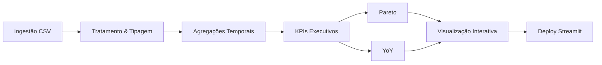

> This repository is part of the **Revenue-Intelligence-Platform-Suite**
> Main platform: [../../README.md](../../README.md)

## Language
- English: [README.en.md](README.en.md)
- Portugues (BR): [README.md](README.md)
- Portugues (PT): [README.pt-PT.md](README.pt-PT.md)

# Sales Analytics Dashboard

[](https://www.python.org/downloads/)
[](https://pandas.pydata.org/)
[](https://numpy.org/)
[](https://streamlit.io/)
[](https://plotly.com/python/)
[](https://www.docker.com/)
[](https://docs.pytest.org/)
[](../../LICENSE)

Demo: https://sales-analytics-dashboardd.streamlit.app/  
Repository: https://github.com/samuelmaiapro/analise-vendas-python

## At A Glance
| Area | Summary |
|---|---|
| Primary use case | Operational sales analytics for transactional datasets |
| Core strengths | KPI summarization, Pareto concentration, YoY analysis, Streamlit delivery |
| Primary buyers | Sales leadership, commercial ops, business analysts |
| Platform role | Supports `Commercial Performance Analytics` |

## Summary
- Executive Summary
- Data Source
- Tech Stack
- How to Run
- Where it fits in the platform

## Executive Summary

Projeto **end-to-end de Sales Analytics**, estruturado como um caso real de negócio.

O sistema transforma dados transacionais em decisões estratégicas por meio de:

- análise de crescimento periódico
- métricas executivas consolidadas
- análise de concentração com Pareto automático
- comparação Year-over-Year (YoY)
- visualizações interativas

## Business Outcomes
- acelerar revisões comerciais com KPIs e tendências prontos para liderança
- identificar concentração excessiva de receita por produto, categoria ou dimensão
- mostrar sazonalidade e comparações YoY sem trabalho manual em planilhas
- reforçar a oferta da plataforma para contextos de vendas com datasets transacionais leves

## Data Source

### Dynamic CSV Upload
- Seleção automática de coluna de data  
- Seleção automática de coluna de valor  
- Compatível com qualquer dataset transacional  

### Base Dataset

Kaggle – Sample Sales Data  
https://www.kaggle.com/datasets/kyanyoga/sample-sales-data  

Principais resultados identificados:

- Receita total analisada: **$10M+**
- Crescimento médio mensal: **~14%**
- Top 3 linhas de produto representam **~70% da receita**
- Pico sazonal identificado em **novembro**

### Simulated Fallback Data

Fallback automático com:
- Tendência de crescimento  
- Sazonalidade anual  
- Ruído estatístico controlado  

## Executive Metrics

- Receita Total
- Pico Sazonal
- Concentração Top 3 por dimensão
- Crescimento Médio
- Melhor e Pior Período
- YoY mensal

## Pareto Analysis

O sistema gera automaticamente:

- Ranking por dimensão (produto, categoria, país, etc.)
- Percentual individual de participação
- Percentual acumulado
- Visualização combinada (barras + linha acumulada)

Permite identificar concentração de receita e risco de dependência.

## YoY Comparison

Cálculo automático de:

- Total mensal agregado
- Variação absoluta YoY
- Variação percentual YoY
- Visualização com eixo duplo (Total + % YoY)

Permite avaliar crescimento sustentável e sazonalidade estrutural.

## Data Flow


## Architecture Notes

Estruturado com foco em separação de responsabilidades:

- funções utilitárias isoladas
- cálculos desacoplados
- funções dedicadas para Pareto e YoY
- cache inteligente (`@st.cache_data`)
- tratamento seguro de tipos
- fallback robusto de dados

## Executive Business Case

### Risk Identified
Alta concentração de receita (~70%) em poucas linhas de produto.

### Opportunity
Crescimento médio mensal consistente (~14%).

### Recommended Strategy
Diversificação de portfólio

Planejamento antecipado para pico sazonal (Q4)

Padronização e governança de KPIs

## Technology Stack

Python

Pandas

NumPy

Plotly

Streamlit

Docker

Pytest

## Run
Local
```
streamlit run app.py
```
Docker
```
docker-compose up --build
```

## Roadmap

Integração com banco de dados

Pipeline ETL automatizado

Monitoramento de performance

Deploy escalável em cloud

Camada semântica de métricas

## Strategic Differentiation

Este projeto demonstra:

Capacidade técnica end-to-end

Tradução de dados em decisões executivas

Arquitetura preparada para evolução

Maturidade analítica e visão estratégica

## Where it fits in the platform
- Layer: App + Analytics
- Inputs: Transactional sales data, product and channel dimensions
- Outputs: Interactive sales dashboards, business KPIs, actionable analysis for leadership


