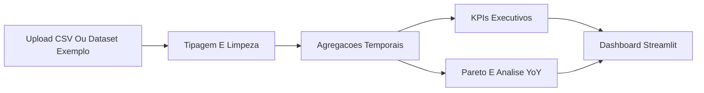

> This repository is part of the **Revenue-Intelligence-Platform-Suite**
> Main platform: [../../README.md](../../README.md)

# Sales Analytics Dashboard

## Idioma
- English: [README.en.md](README.en.md)
- Portugues (BR): [README.md](README.md)
- Portugues (PT): [README.pt-PT.md](README.pt-PT.md)

## Proposito
Este modulo representa a camada de analytics comercial operacional da suite. Transforma dados transacionais de vendas em KPIs executivos, leitura de crescimento, analise de concentracao e sinais de sazonalidade.

## O Que Entrega
- analise de crescimento entre periodos
- KPIs executivos de vendas
- visoes de Pareto por produto, categoria ou geografia
- comparacoes YoY e deteccao de sazonalidade
- entrega interactiva em Streamlit para utilizadores de negocio

## Fluxo


## Como Encaixa Na Plataforma
- suporta `Commercial Performance Analytics`
- fornece narrativa de KPI comercial para o portal executivo
- reforca a capacidade da suite para trabalhar com datasets transacionais mais leves

## Execucao Local
```bash
cd modules/analise-vendas-python
python -m venv .venv
# Linux/macOS
source .venv/bin/activate
# Windows PowerShell
.venv\Scripts\Activate.ps1
pip install -r requirements.txt
streamlit run app.py
```

## Demo Publica
- Demo: https://sales-analytics-dashboardd.streamlit.app/
- Repositorio: https://github.com/samuelmaiapro/analise-vendas-python
