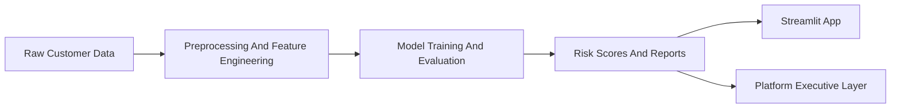

> This repository is part of the **Revenue-Intelligence-Platform-Suite**
> Main platform: ../../README.md

# Churn Prediction

## Language
- English: [README.md](README.md)
- Portugues (BR): [docs/README.pt-BR.md](docs/README.pt-BR.md)
- Portugues (PT): [docs/README.pt-PT.md](docs/README.pt-PT.md)

## Purpose
This module focuses on churn-risk modeling and retention-oriented decision support. It packages data preparation, feature engineering, model evaluation, contracts, and a Streamlit experience into a reusable retention analytics asset.

## What It Delivers
- churn-risk scoring inputs for retention prioritization
- reproducible preprocessing and modeling steps
- governance-aware contracts and report outputs
- a dashboard surface for client-facing retention narratives

## Architecture


## Repository Shape
```text
modules/churn-prediction/
|- app/
|- assets/
|- contracts/
|- data/
|- docs/
|- notebooks/
|- reports/
|- scripts/
|- src/
|- tests/
|- main.py
`- streamlit_app.py
```

## How It Fits In The Platform
- solution package support: `Retention Intelligence`
- analytical role: identify churn exposure and feed prioritized action layers
- platform value: strengthens the suite's retention and customer-risk credibility

## Run Locally
```bash
cd modules/churn-prediction
python -m venv .venv
# Linux/macOS
source .venv/bin/activate
# Windows PowerShell
.venv\Scripts\Activate.ps1
pip install -r requirements.txt
streamlit run streamlit_app.py
```

## Notes
This module should keep its own domain identity, but its README now follows the same product-oriented framing used across the platform suite.
