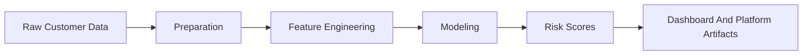

# Churn Prediction Docs

## Purpose
This document set supports the `churn-prediction` module with language-specific navigation and implementation context.

## Main Entry Points
- Module README: [../README.md](../README.md)
- Portuguese (BR): [README.pt-BR.md](README.pt-BR.md)
- Portuguese (PT): [README.pt-PT.md](README.pt-PT.md)

## What This Module Is About
`churn-prediction` is the retention-risk modeling component of the platform suite. It exists to identify churn exposure, support retention prioritization, and provide model-backed signals that can feed executive review flows.

## Architecture At A Glance

## Recommended Reading Order
1. Read [../README.md](../README.md) for module positioning.
2. Review contracts, reports, and scripts in the module root.
3. Connect the module back to the suite-level platform in [../../../README.md](../../../README.md).
