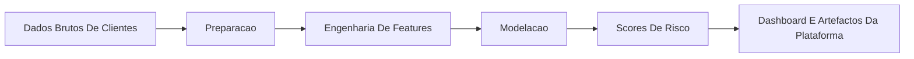

# Documentacao Do Churn Prediction

## Proposito
Este conjunto de documentos apoia o modulo `churn-prediction` com navegacao por idioma e contexto de implementacao.

## Pontos Principais
- README do modulo: [../README.md](../README.md)
- English: [README.en.md](README.en.md)
- Portugues (BR): [README.pt-BR.md](README.pt-BR.md)

## Sobre O Modulo
`churn-prediction` e o componente de modelacao de risco de churn da plataforma. Existe para identificar exposicao de cancelamento, apoiar a priorizacao de retencao e fornecer sinais modelados para fluxos executivos de revisao.

## Arquitetura Em Alto Nivel

## Ordem Recomendada De Leitura
1. Ler [../README.md](../README.md) para o posicionamento do modulo.
2. Rever contratos, reports e scripts na raiz do modulo.
3. Ligar o modulo a suite principal em [../../../README.md](../../../README.md).
