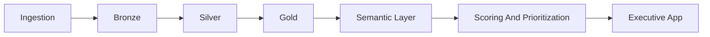

# Revenue Intelligence Platform

Revenue Intelligence Platform is a portfolio-grade revenue analytics case built to show how analytics engineering, business semantics, predictive modeling, and executive storytelling can work together in one product. It transforms customer behavior, transaction history, and marketing spend into a commercial decision system for growth and retention.

## At A Glance
| Area | Summary |
|---|---|
| Primary use case | Revenue command layer for growth, retention, and executive review |
| Core strengths | Semantic metrics, predictive scoring, layered pipeline, executive storytelling |
| Primary buyers | CRO, RevOps, Customer Success leadership, strategy teams |
| Platform role | Flagship module for `Revenue Command Center` |

## Why This Project Matters

Most analytics projects stop at dashboards or notebooks. This one is intentionally positioned as a more senior implementation:

- clear separation between ingestion, transformation, semantic modeling, orchestration, and presentation
- reusable KPI definitions instead of logic duplicated across reports and UI
- data quality checks and structured logging as first-class concerns
- an executive-facing application built on top of prepared analytical artifacts

The result is not just an analysis. It is a decision product.

## Business Context

Commercial and revenue teams usually need fast answers to a few recurring questions:

- Where is revenue growing, slowing down, or leaking?
- Which acquisition channels are efficient enough to keep funding?
- Which customer segments show the highest churn exposure?
- Which accounts deserve retention, upsell, nurture, or spend reduction actions first?

This project consolidates those questions into a reproducible pipeline and an executive decision layer.

## What The Product Delivers

- executive visibility into `Revenue`, `Growth Rate`, `ARPU`, `Retention`, and `Churn`
- channel-level unit economics using `CAC`, `LTV`, `LTV/CAC`, contribution margin, and payback
- customer prioritization with modeled churn risk and next-purchase propensity
- simulated business impact for recommended commercial actions
- an application flow designed for leadership review, not analyst-only exploration

## Business Outcomes
- faster weekly and monthly revenue reviews with fewer KPI definition disputes
- clearer prioritization of retention and channel-allocation decisions
- reusable semantic definitions that reduce rework across dashboards and reports
- stronger executive trust because analytics outputs are prepared, validated, and narratively framed

## Architecture Decisions

The project is organized with a layered analytics-engineering structure:

```text
modules/revenue-intelligence/
|- app/
|  \- streamlit_app.py
|- data/
|  |- raw/
|  |- bronze/
|  |- silver/
|  |- gold/
|  \- processed/
|- docs/
|  \- architecture.md
|- logs/
|- src/
|  |- analytics/
|  |- core/
|  |- dashboard/
|  |- ingestion/
|  |- models/
|  |- orchestration/
|  |- quality/
|  |- transform/
|  |- config.py
|  |- metrics.py
|  \- pipeline.py
|- tests/
|- .env.example
|- main.py
|- run_pipeline.py
\- README.md
```

Detailed architecture: [docs/architecture.md](/C:/Users/samue/PycharmProjects/revenue-intelligence-platform-suite/modules/revenue-intelligence/docs/architecture.md)

Key design choices:

- `src/analytics/semantic_layer.py` centralizes KPI definitions and business formulas
- `src/quality/validation.py` enforces required columns, null checks, duplicate checks, and consistency
- `src/orchestration/pipeline.py` coordinates the end-to-end pipeline with stage-level logs
- `src/dashboard/service.py` keeps analytical logic out of Streamlit
- `app/streamlit_app.py` is intentionally focused on executive consumption and narrative

## Key Metrics

Business definitions are centralized in the semantic layer:

- `Revenue`: total order value generated by the portfolio
- `Growth Rate`: period-over-period revenue variation
- `ARPU`: average revenue per active customer
- `Retention`: active customers divided by cohort size
- `Churn`: `1 - retention` or predicted churn risk depending on the view
- `LTV`: expected lifetime value derived from ARPU, churn, and margin assumptions
- `CAC`: acquisition cost by channel
- `LTV/CAC`: efficiency indicator for capital allocation

This is one of the strongest seniority upgrades in the project because it removes KPI ambiguity and makes the business layer reusable.

## End-to-End Flow

1. Ingestion reads the Kaggle source or creates deterministic synthetic fallback data.
2. Bronze stores auditable raw copies with ingestion metadata.
3. Silver standardizes schema and validates quality rules.
4. Feature engineering prepares customer-level analytical attributes.
5. Gold publishes a star schema for downstream analytical use.
6. Modeling scores churn and next-purchase probability.
7. The semantic layer computes KPIs, unit economics, and action prioritization.
8. Streamlit reads prepared artifacts through a backend service layer.

## Architecture Flow


## Executive App Flow

The dashboard is organized as a leadership review flow:

1. `Overview`: revenue posture, action mix, and channel efficiency
2. `Trend`: revenue trend, ARPU trend, and cohort retention
3. `Segmentation`: churn by segment, purchase propensity by channel, portfolio map
4. `Insights`: top opportunities, simulated business impact, prioritized action list

This structure makes the project stronger as a portfolio case because it demonstrates not only analysis, but also narrative design for decision-making.

## Local Execution

```powershell
py -3.11 -m venv .venv
.\.venv\Scripts\activate
python -m pip install --upgrade pip
python -m pip install -r requirements.txt
Copy-Item .env.example .env
python run_pipeline.py
python -m streamlit run .\app\streamlit_app.py
```

Alternative CLI:

```powershell
python -m src.pipeline run
python -m src.pipeline run --seed 123 --log-level DEBUG
```

## Reliability And Engineering Quality

The refactored version adds the controls expected in a professional analytics project:

- structured JSON logging by pipeline stage in `logs/pipeline.log`
- centralized runtime configuration through environment variables
- quality validation for required columns, nulls, duplicates, and referential consistency
- tests for semantic KPIs, transformations, reporting outputs, and contracts
- separation between analytical backend and presentation layer

Reference config: [.env.example](/C:/Users/samue/PycharmProjects/revenue-intelligence-platform-suite/modules/revenue-intelligence/.env.example)

## Results

Core generated outputs:

- `data/processed/scored_customers.csv`
- `data/processed/recommendations.csv`
- `data/processed/cohort_retention.csv`
- `data/processed/unit_economics.csv`
- `data/processed/business_outcomes.json`
- `data/processed/executive_report.json`
- `data/processed/top_10_actions.csv`
- `data/processed/data_quality_report.json`

## Portfolio Positioning

This project is strongest when presented as:

- an analytics engineering case with layered data architecture
- a revenue analytics case with clear business semantics
- a decision-support product with predictive scoring and prioritization
- a demonstration of seniority through structure, robustness, and executive communication

## Role, Trade-Offs, And Next Steps

### Role Framing

This project can be presented as the work of someone operating across analytics engineering, applied analytics, and product thinking:

- structuring the pipeline and analytical layers
- defining reusable business metrics
- adding quality and observability controls
- separating backend analytics from presentation
- translating analytical outputs into an executive narrative

### Main Technical Decisions

- keep the pipeline modular so each layer has a clear responsibility
- centralize business logic in a semantic layer instead of duplicating formulas
- validate data before downstream analytics and scoring
- treat logging and reproducibility as part of the product, not as optional extras
- keep Streamlit focused on consumption, filtering, and storytelling

### Trade-Offs

- the project favors clarity and reproducibility over heavy infrastructure complexity
- the semantic layer is implemented in Python for accessibility, even though it could later evolve into dbt or warehouse-native metrics
- the modeling layer is intentionally pragmatic and interpretable rather than optimized for maximum experimentation depth

### Next Steps

- publish curated screenshots or a short walkthrough GIF of the executive app
- add benchmark scenarios for retention and channel reallocation decisions
- extend the semantic layer to warehouse-native models and dbt tests
- add CI artifacts for data quality and model monitoring outputs
- expose the top decisions in an API or scheduled executive report
