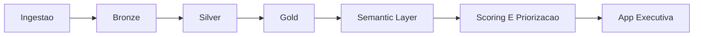

# Revenue Intelligence Platform

Revenue Intelligence Platform e um case de portfolio orientado a revenue analytics, pensado para demonstrar como analytics engineering, semantica de negocio, modelacao preditiva e storytelling executivo podem funcionar em conjunto num unico produto. O projeto transforma comportamento de clientes, historico transacional e investimento em marketing num sistema de decisao para crescimento e retencao.

## Porque este projeto importa

Muitos projetos de dados ficam limitados a dashboards ou notebooks. Este foi reposicionado para representar uma implementacao mais senior:

- separacao clara entre ingestao, transformacao, camada semantica, orquestracao e apresentacao
- definicoes reutilizaveis de KPI em vez de logica dispersa por relatorios e interface
- qualidade de dados e logging estruturado como responsabilidades de primeira linha
- uma aplicacao executiva construida sobre artefactos analiticos preparados

O resultado nao e apenas uma analise. E um produto de decisao.

## Contexto de negocio

Liderancas comerciais e de receita precisam normalmente de responder com rapidez a algumas perguntas recorrentes:

- Onde esta a receita a crescer, a desacelerar ou a perder-se?
- Que canais de aquisicao sao eficientes o suficiente para continuar a receber investimento?
- Que segmentos concentram o maior risco de churn?
- Que contas merecem prioridade em retencao, upsell, nurture ou reducao de investimento?

Este projeto consolida essas perguntas num pipeline reproduzivel e numa camada executiva de decisao.

## O que o produto entrega

- visao executiva de `Revenue`, `Growth Rate`, `ARPU`, `Retention` e `Churn`
- unit economics por canal com `CAC`, `LTV`, `LTV/CAC`, margem de contribuicao e payback
- priorizacao de clientes com risco de churn e propensao de compra
- simulacao de impacto para acoes comerciais recomendadas
- um fluxo de aplicacao pensado para reunioes de lideranca, e nao apenas para exploracao analitica

## Decisoes de arquitetura

O projeto foi organizado com uma estrutura profissional de analytics engineering:

```text
modules/revenue-intelligence/
|- app/
|  \- streamlit_app.py
|- data/
|  |- raw/
|  |- bronze/
|  |- silver/
|  |- gold/
|  \- processed/
|- docs/
|  \- architecture.md
|- logs/
|- src/
|  |- analytics/
|  |- core/
|  |- dashboard/
|  |- ingestion/
|  |- models/
|  |- orchestration/
|  |- quality/
|  |- transform/
|  |- config.py
|  |- metrics.py
|  \- pipeline.py
|- tests/
|- .env.example
|- main.py
|- run_pipeline.py
\- README.md
```

Arquitetura detalhada: [docs/architecture.md](/C:/Users/samue/PycharmProjects/revenue-intelligence-platform-suite/modules/revenue-intelligence/docs/architecture.md)

Principais escolhas de design:

- `src/analytics/semantic_layer.py` centraliza KPIs e formulas de negocio
- `src/quality/validation.py` valida colunas obrigatorias, nulos, duplicados e consistencia
- `src/orchestration/pipeline.py` coordena o pipeline ponta a ponta com logs por etapa
- `src/dashboard/service.py` evita que a logica analitica fique acoplada ao Streamlit
- `app/streamlit_app.py` fica focado em narrativa executiva e consumo

## Fluxo de arquitetura



## Metricas-chave

As definicoes de negocio foram centralizadas na camada semantica:

- `Revenue`: valor total gerado pelas encomendas
- `Growth Rate`: variacao de receita entre periodos
- `ARPU`: receita media por cliente ativo
- `Retention`: clientes ativos divididos pelo tamanho da coorte
- `Churn`: `1 - retention` ou risco previsto, conforme a visao
- `LTV`: lifetime value esperado com base em ARPU, churn e margem
- `CAC`: custo de aquisicao por canal
- `LTV/CAC`: indicador de eficiencia para alocacao de capital

Este e um dos maiores ganhos de senioridade do projeto, porque reduz ambiguidade de KPI e torna a camada de negocio reutilizavel.

## Fluxo ponta a ponta

1. A ingestao le a fonte do Kaggle ou gera fallback sintetico deterministico.
2. A Bronze guarda copias auditaveis com metadados de ingestao.
3. A Silver normaliza o schema e valida regras de qualidade.
4. A engenharia de features prepara atributos analiticos por cliente.
5. A Gold publica um star schema para reutilizacao analitica.
6. A modelacao calcula churn e probabilidade de compra seguinte.
7. A camada semantica calcula KPIs, unit economics e priorizacao de acoes.
8. O Streamlit consome artefactos prontos atraves de uma camada de servico.

## Como este modulo reforca a suite

- suporta o pacote `Revenue Command Center`
- fornece a base mais forte de semantic layer, scoring e narrativa executiva
- demonstra como a plataforma junta analytics engineering, governanca e consumo de lideranca

## Fluxo executivo da app

O dashboard foi organizado como um fluxo de revisao de lideranca:

1. `Overview`: postura de receita, mix de acoes e eficiencia por canal
2. `Trend`: tendencia de receita, tendencia de ARPU e retencao por coorte
3. `Segmentation`: churn por segmento, propensao de compra por canal e mapa da carteira
4. `Insights`: melhores oportunidades, impacto simulado e lista priorizada

Esta estrutura reforca o projeto como case de portfolio porque demonstra nao apenas analise, mas tambem design de narrativa para tomada de decisao.

## Execucao local

```powershell
py -3.11 -m venv .venv
.\.venv\Scripts\activate
python -m pip install --upgrade pip
python -m pip install -r requirements.txt
Copy-Item .env.example .env
python run_pipeline.py
python -m streamlit run .\app\streamlit_app.py
```

CLI alternativa:

```powershell
python -m src.pipeline run
python -m src.pipeline run --seed 123 --log-level DEBUG
```

## Fiabilidade e qualidade de engenharia

A versao refatorada adiciona controlos esperados num projeto profissional de analytics:

- logging estruturado em JSON por etapa em `logs/pipeline.log`
- configuracao centralizada por variaveis de ambiente
- validacao de qualidade para colunas obrigatorias, nulos, duplicados e consistencia referencial
- testes para KPIs, transformacoes, relatorios e contratos
- separacao clara entre backend analitico e camada de apresentacao

Referencia de configuracao: [.env.example](/C:/Users/samue/PycharmProjects/revenue-intelligence-platform-suite/modules/revenue-intelligence/.env.example)

## Resultados

Saidas principais geradas pelo pipeline:

- `data/processed/scored_customers.csv`
- `data/processed/recommendations.csv`
- `data/processed/cohort_retention.csv`
- `data/processed/unit_economics.csv`
- `data/processed/business_outcomes.json`
- `data/processed/executive_report.json`
- `data/processed/top_10_actions.csv`
- `data/processed/data_quality_report.json`

## Posicionamento de portfolio

Este projeto torna-se mais forte quando apresentado como:

- um case de analytics engineering com arquitetura em camadas
- um case de revenue analytics com semantica clara de negocio
- um produto de suporte a decisao com scoring e priorizacao
- uma demonstracao de senioridade atraves de estrutura, robustez e comunicacao executiva

## Papel, Trade-Offs E Proximos Passos

### Enquadramento do papel

Este projeto pode ser apresentado como o trabalho de alguem a operar na intersecao entre analytics engineering, analytics aplicado e product thinking:

- estruturando o pipeline e as camadas analiticas
- definindo metricas de negocio reutilizaveis
- adicionando controlos de qualidade e observabilidade
- separando backend analitico da camada de apresentacao
- transformando saidas analiticas em narrativa executiva

### Principais decisoes tecnicas

- manter o pipeline modular para que cada camada tenha responsabilidade clara
- centralizar regras de negocio na camada semantica em vez de repetir formulas
- validar os dados antes das etapas de analytics e scoring
- tratar logging e reprodutibilidade como parte do produto, e nao como detalhe opcional
- deixar o Streamlit focado em consumo, filtros e storytelling

### Trade-offs

- o projeto privilegia clareza e reprodutibilidade em vez de complexidade excessiva de infraestrutura
- a camada semantica foi implementada em Python por acessibilidade, embora possa evoluir para dbt ou metricas nativas de warehouse
- a modelacao foi mantida pragmatica e interpretavel, em vez de maximizar profundidade de experimentacao

### Proximos passos

- publicar screenshots curadas ou um GIF curto da app executiva
- adicionar cenarios comparativos para retencao e realocacao de investimento por canal
- expandir a camada semantica para modelos nativos em warehouse e testes dbt
- adicionar artefactos de CI para qualidade de dados e monitorizacao de modelos
- expor as principais decisoes via API ou relatorio executivo agendado
